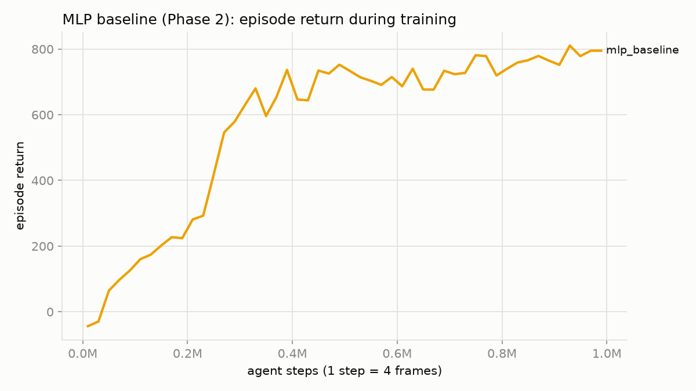

# Connectome Driver

Can the wiring diagram of a fly brain learn to drive a car?

This project uses the complete *Drosophila melanogaster* connectome (FlyWire, ~139k neurons)
as the **architecture** of a reinforcement-learning policy for Gymnasium's `CarRacing-v3`.
Camera frames are encoded into the visual afferent neurons, activity propagates through the
connectome by message passing, and the actions are read out from the descending neurons.

The question: does the structural bias of the connectome still help on a task it never
evolved for, in a body that is not its own? To answer it, the real connectome is compared
against degree-preserving rewired graphs, random graphs, a parameter-matched MLP and a
no-core ablation, with the same encoder, decoder, PPO and hyperparameters everywhere.

> **Status:** work in progress. Phase 1 (connectome data pipeline) is in place; training
> code and results will follow. No results are reported until they come from real runs.

## Setup

Python 3.11+. PyTorch is installed from the CUDA wheel index that matches your driver:

```bash
python -m venv .venv
.venv/Scripts/activate            # Windows; use `source .venv/bin/activate` elsewhere
pip install torch --index-url https://download.pytorch.org/whl/cu126
pip install -e ".[dev]"
```

## Data

The FlyWire data is **not** included in this repository. Download it yourself from
[FlyWire Codex](https://codex.flywire.ai/api/download?dataset=fafb) (sign-in required, dataset
**FAFB v783**), agreeing to the FlyWire citation guidelines, and place these files in `data/raw/`:

| Codex entry | File | Content |
|---|---|---|
| Connections (Filtered) | `connections_princeton.csv.gz` | One row per (pre, post, neuropil); pairs with >= 5 synapses |
| Classification / Hierarchical Annotations | `classification.csv.gz` | `flow`, `super_class`, `class`, `sub_class`, `side`, ... |
| Neurotransmitter Type Predictions | `neurons.csv.gz` | Predicted neurotransmitter per neuron |

About 14% of neurons have no neuron-level neurotransmitter prediction. For them the
transmitter label on their outgoing connections is used instead (it is unique per neuron, and
it always matches the neuron-level prediction where both exist).

Then inspect and preprocess:

```bash
python scripts/inspect_raw.py                 # prints the real columns and value counts
python scripts/preprocess_connectome.py       # writes data/processed/
python scripts/graph_stats.py                 # partition counts, degrees, path lengths
```

Raw and processed files are git-ignored.

## Training

The environment is `CarRacing-v3` with **discrete actions** (noop, right, left, gas, brake),
**frame skip 4**, grayscale 84x84 frames and a stack of 4. Rewards are clipped to [-1, 1] for
training only; every return reported here is the standard, unclipped CarRacing score.
Rendering is the bottleneck of CarRacing, so frames skipped by the agent are simulated without
being rendered; a test checks that this leaves the dynamics identical to the original env.

```bash
python scripts/train.py --model configs/model/mlp.yaml exp_name=mlp_baseline seed=1
python scripts/evaluate.py runs/mlp_baseline/seed1 --episodes 20
python scripts/plot_curves.py runs/mlp_baseline --out results/mlp_baseline_curve.png
tensorboard --logdir runs
```

Each run writes `runs/<exp_name>/seed<k>/` with the config, `episodes.csv` (every finished
episode), `iterations.csv` (losses, timings, GPU memory), TensorBoard logs and the final policy.
Step counts are agent steps summed over the 8 parallel environments (1 agent step = 4 frames).

### Baseline: MLP core (1 seed, sanity check)

Before plugging in the connectome, the pipeline was checked with a plain MLP core
(encoder 122k parameters, core 2.77M, decoder 2.67M), trained for 1M agent steps
(4M frames, 71 minutes on an RTX 3070 Ti Laptop).



| Metric | Value |
|---|---|
| Mean return, last 100 training episodes | 793.3 |
| Evaluation on 20 unseen tracks, sampled actions | 786.9 ± 148.6 |
| Evaluation on 20 unseen tracks, greedy actions | 745.4 ± 184.1 |
| First step where the 20-episode mean reached 500 / 700 / 800 | 258k / 325k / 489k |
| Policy forward per rollout step (8 envs) / update per minibatch (256) | 4.5 ms / 28.9 ms |
| Peak GPU memory | 200 MB |

This is a single seed and only shows that the pipeline learns; the comparison between cores
uses at least 3 seeds per variant.

### Citing FlyWire

If you use this code with FlyWire data, cite the FlyWire papers as required by the
FlyWire terms of use (check Codex for the current list):

- Dorkenwald, S. et al. Neuronal wiring diagram of an adult brain. *Nature* 634, 124–138 (2024).
- Schlegel, P. et al. Whole-brain annotation and multi-connectome cell typing of
  *Drosophila*. *Nature* 634, 139–152 (2024).
- Eckstein, N. et al. Neurotransmitter classification from electron microscopy images at
  synaptic sites in *Drosophila melanogaster*. *Cell* 187, 2574–2594 (2024).

## Related work

- FlyGM (arXiv:2602.17997) uses the FlyWire connectome as a message-passing controller for a
  simulated fly body. This project asks a different question: whether that structural prior
  transfers to a body and a task the fly never evolved for.
- Shiu, P. K. et al. A *Drosophila* computational brain model reveals sensorimotor
  processing. *Nature* 634, 210–219 (2024). Source of the default neurotransmitter signs.

## License

Code: MIT (see `LICENSE`). The FlyWire data is subject to its own terms.
